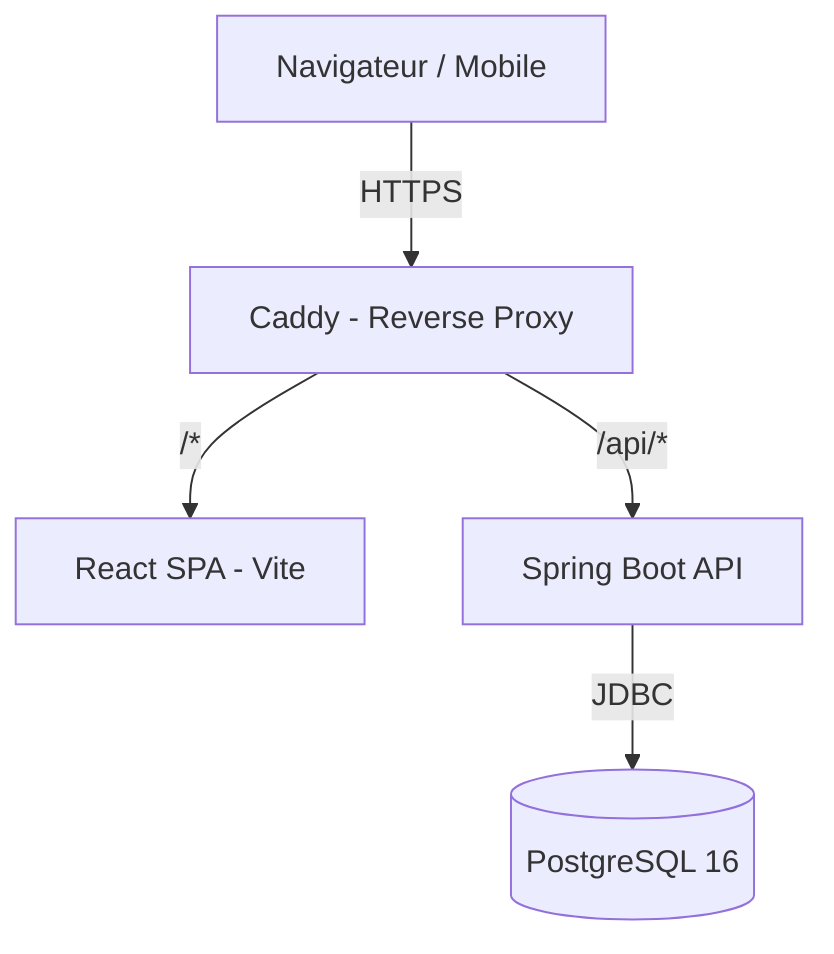
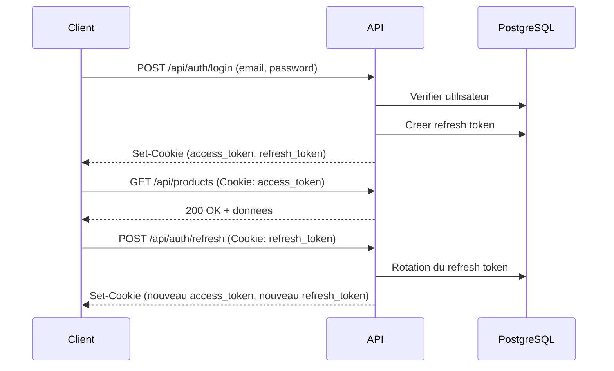
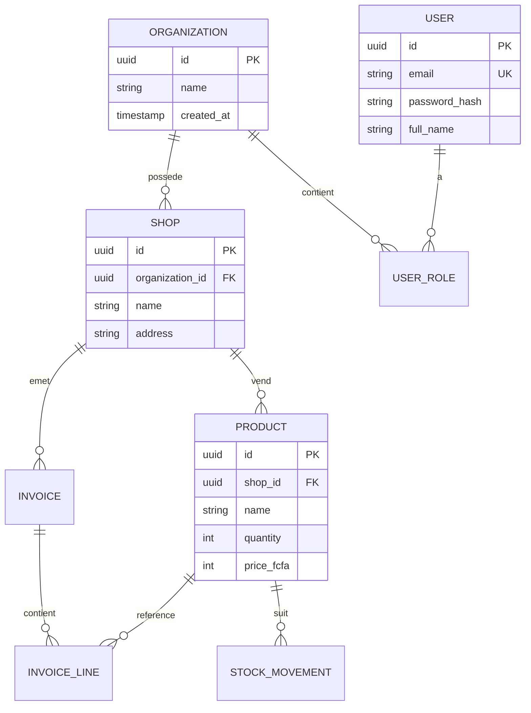

# Architecture -- Kassa

## Vue d'ensemble

Kassa suit une architecture monorepo avec separation claire entre l'API (backend), le frontend (web) et l'infrastructure.

```
kassa/
  apps/
    api/            # API REST -- Spring Boot 3, Java 21
    web/            # Frontend -- React, TypeScript, Vite
  infra/
    caddy/          # Reverse proxy et TLS
    docker-compose.yml
  docs/
  .github/workflows/
```

## Schema d'architecture



## Flux d'authentification



## Modele de donnees (simplifie)



## Decisions techniques

Voir [DECISIONS.md](DECISIONS.md) pour le journal des decisions d'architecture (ADR).

## Services Docker

| Service | Port interne | Description |
|---------|-------------|-------------|
| `db` | 5432 | PostgreSQL 16 |
| `api` | 8080 | API Spring Boot |
| `web` | 5173 | Serveur de dev Vite |
| `caddy` | 80, 443 | Reverse proxy |
